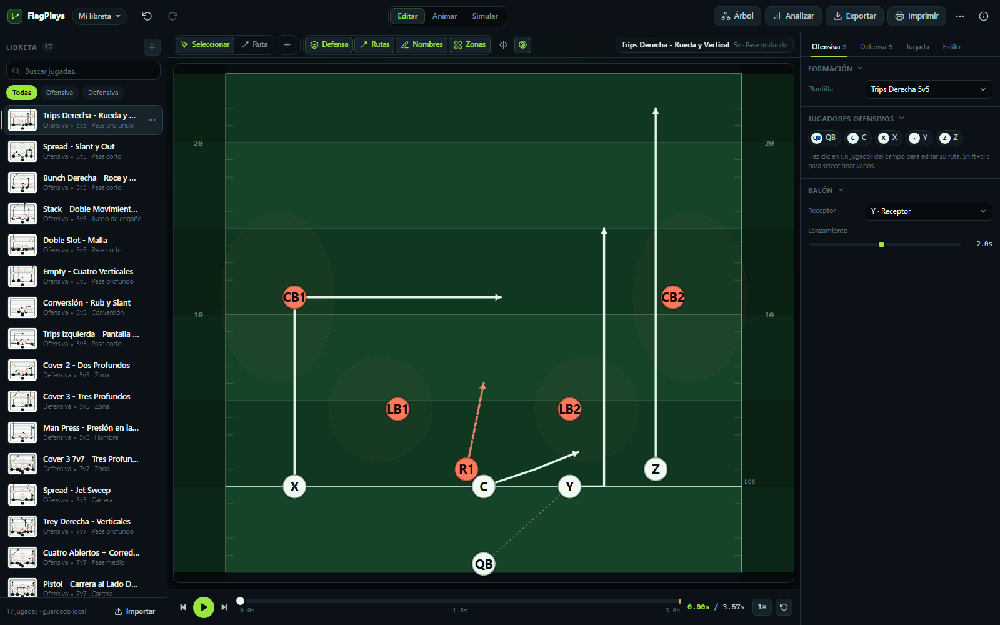
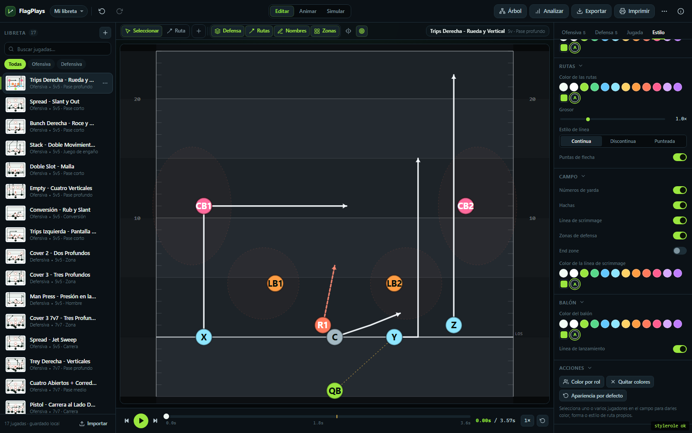
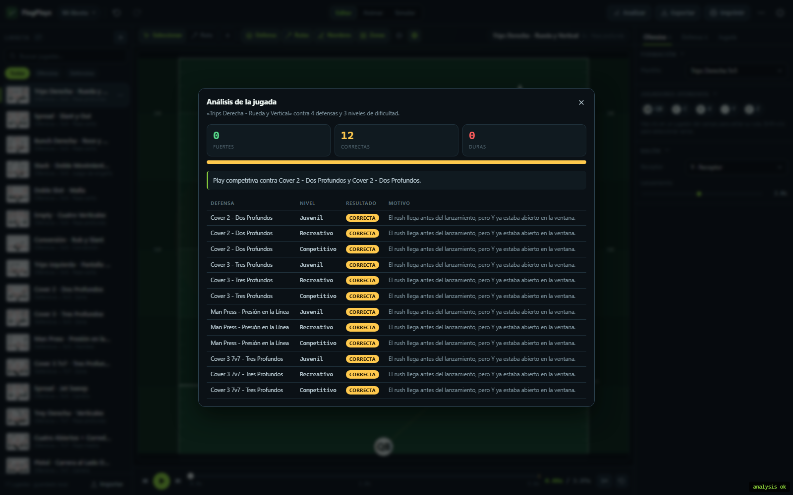
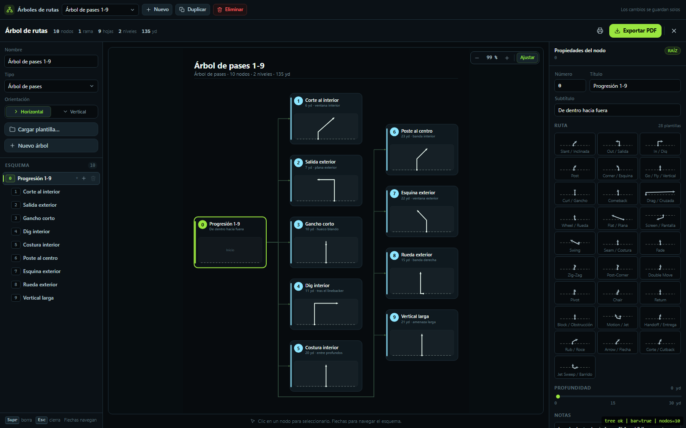
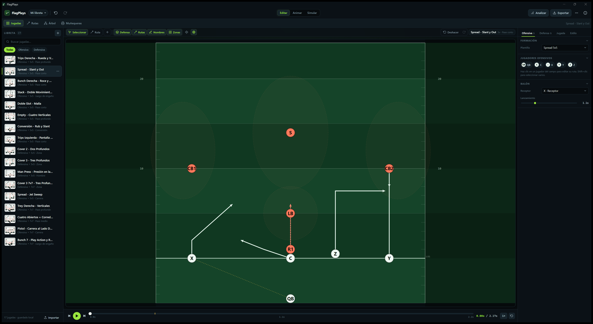
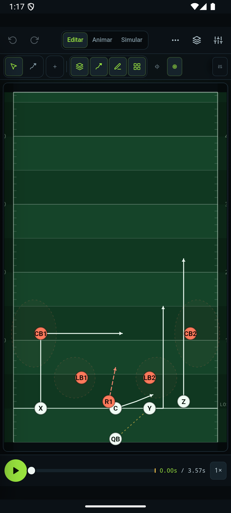
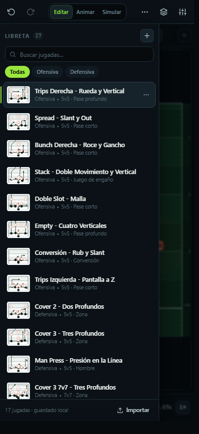

# FlagPlays

**Pizarra y libreta de jugadas de flag football.** Diseña, anima, simula, analiza e imprime
jugadas en 5v5, 7v7 y el resto de formatos. Funciona en el navegador, sin cuenta y sin
instalar nada.









## Cómo arrancarlo

```bash
node server.mjs          # http://127.0.0.1:5173
```

O con npm:

```bash
npm start
```

No hay dependencias: ni `npm install`, ni build, ni CDN. Es HTML + módulos ES nativos
servidos por un servidor estático de 40 líneas (`server.mjs`).

> También puedes abrir `index.html` con doble clic, pero algunos navegadores bloquean los
> módulos ES desde `file://`; con el servidor funciona siempre.

## App nativa de Windows (sin servidor y sin internet)

`FlagPlays.exe` es una aplicación de escritorio **nativa**: se abre con doble clic, no
necesita `node`, no arranca ningún servidor local y funciona **sin conexión a internet**.

**Para pasar a los amigos:** `dist\Instalador-FlagPlays-1.0.exe` (2,4 MB). Doble clic,
siguiente, instalar. **No pide administrador** (se instala por usuario en
`%LOCALAPPDATA%\Programs\FlagPlays`), crea accesos en el escritorio y el menú Inicio,
aparece en *Aplicaciones instaladas* con su desinstalador y **no borra las jugadas al
desinstalar**. Windows mostrará el aviso de SmartScreen por no estar firmado: *Más
información → Ejecutar de todos modos* (solo la primera vez).

```powershell
pwsh -NoProfile -ExecutionPolicy Bypass -File tools\build-win.ps1        # exe + zip
pwsh -NoProfile -ExecutionPolicy Bypass -File tools\build-installer.ps1  # instalador (usa Inno Setup 6)
```

Genera también `dist\windows\FlagPlays\` (portable: exe + 3 DLLs + `www/`, ~1 MB) y
`dist\FlagPlays-Windows-x64.zip`. Detalles en **[docs/WINDOWS.md](docs/WINDOWS.md)**.

- Hospeda la web en el **motor WebView2** que ya trae Windows (no empaqueta Chromium ni
  Node): el `.exe` pesa 56 KB y el motor es el del sistema.
- **Sin servidor**: los ficheros se sirven desde disco con un mapeo de host virtual
  (`https://appassets.local/` → `www/`). No se abre ningún puerto.
- **Sin internet**: cero peticiones externas y, además, la app cancela cualquier navegación
  que no sea a su propio origen.
- Exportar PDF/PNG/JSON guarda en **Descargas**; «Imprimir» abre el diálogo de Windows con
  *Print to PDF*; la libreta y el tamaño de ventana persisten entre sesiones.



## Instalable en el móvil (APK)

Además de la versión web, FlagPlays se empaqueta como **APK de Android** para instalarla
como una app normal (sin navegador y sin conexión):

```powershell
powershell -ExecutionPolicy Bypass -File tools\build-apk.ps1
```

Genera `dist\FlagPlays.apk` (firmado, listo para instalar). Detalles de instalación,
arquitectura del WebView y puente nativo en **[docs/ANDROID.md](docs/ANDROID.md)**.

Dentro de la app funcionan igual el editor, la animación, la simulación, el análisis, los
árboles de rutas y la personalización; y además:

- guarda los PDF, PNG y JSON en la carpeta **Descargas** del teléfono;
- «Imprimir» abre el diálogo de Android, con *Guardar como PDF* incluido;
- el **botón atrás** cierra primero diálogos y paneles y luego sale con confirmación;
- al compartir un enlace usa el selector de compartir del sistema.

La interfaz se adapta a móvil y tableta: **tres paneles convertidos en cajón lateral y hoja
inferior**, conmutador de modo en la barra superior, barra de herramientas deslizable,
controles de 44 px, modales tipo hoja, áreas seguras (notch y barra de gestos) y soporte de
paisaje. El editor de árboles pasa a **un panel a la vez** (Esquema / Árbol / Propiedades).
La versión web además se puede instalar como PWA (`manifest.webmanifest`).





## Secciones

> Las rutas que crees en **Rutas** aparecen también en la jugada y en el **árbol**, marcadas
> como *propias*.

La app tiene cuatro secciones, en la barra de debajo de la cabecera (o con **Ctrl+1…4**):

| Sección | Qué se hace | Atajo |
|---|---|---|
| **Jugadas** | El taller: dibujar jugadas, animarlas y simularlas | `Ctrl+1` |
| **Rutas** | Biblioteca de rutas: crearlas, editarlas punto a punto, duplicarlas y borrarlas | `Ctrl+2` |
| **Árbol** | Árbol de rutas/pases con reordenación arrastrando y exportación a PDF | `Ctrl+3` |
| **Muñequeras** | Hojas de muñequera, call sheet y tarjetas de bolsillo para imprimir | `Ctrl+4` |

### Deshacer

Todo lo que se hace en una jugada se puede deshacer: **Deshacer / Rehacer** están en la
barra del campo (junto al nombre de la jugada) y en la cabecera, con `Ctrl+Z` y `Ctrl+Y`.
También cubre cambios de apariencia, plantillas de ruta, añadir o borrar jugadores y dibujar.

### Editar el árbol de rutas

En la sección **Árbol** se puede cambiar la estructura sin salir de la pantalla:

- **Reordenar**: flechas ↑/↓ en cada fila del esquema, o arrastrar la fila.
- **Mover de sitio**: arrastrar una tarjeta del lienzo sobre otra para que pase a ser su hija,
  o entre dos hermanas para colocarla antes/después.
- **Editar la ruta**: botón **Editar ruta** → arrastrar los puntos del nodo en el propio
  lienzo, clic en la zona para añadir, doble clic o Alt+clic para borrar; o usar el
  **editor de ruta grande** del panel derecho (Limpiar / Invertir / Usar plantilla).
- **Guardar**: botón **Guardar** (o `Ctrl+S`), con el estado visible en la barra; **← Volver**
  para salir.

## Catálogo de jugadas

La sección **Catálogo** (`Ctrl+5`) trae las **20 jugadas del playbook Harriers Sub15**
extraídas del documento del club, cada una con su formación, sus rutas, la lectura del QB,
el truco y cuándo usarla.

Se pueden filtrar combinando cualquiera de estos criterios:

| Filtro | Valores |
|---|---|
| **Tipo** | Pase · Carrera · Engaño |
| **Distancia** | Corta (0-8 yd) · Media (8-15) · Profunda (15+) |
| **Zona que ataca** | Izquierda · Centro · Derecha · Ambos lados |
| **Contra defensa** | Hombre · Zona |
| **Situación** | Campo · Zona roja (endzone) |
| **Formación** | Slot dcha/izda · Trips dcha · Bunch dcha · Cerrada · India |
| **Concepto** | flat, in, slant, cruce, post, vertical, carrera, play-action… |
| **Buscador** | por nombre, concepto o texto de la jugada (ignora tildes) |

Cada jugada se puede **añadir a tu libreta** (queda como jugada normal: puedes renombrarla,
mover jugadores, cambiar rutas, ponerle defensa y color) o **enviarla directamente a la
muñequera**. Todo con una copia propia: el catálogo nunca se modifica.

## Jugadas del club (PDFs)

Además de las 20 del Sub15, el catálogo incluye **84 jugadas reconstruidas de los playbooks
PDF del club** (Beach Bowl, 21 de noviembre, 2 de abril y el playbook del año pasado), ya integradas en el
mismo listado:
Beach 1-20, Booty, Dream, Agua, Palestina, Alas, Luisiana, Arrati, Leo, Pares, los de Abril
y los de nombres de futbolistas (Rui Silva, Moutinho, Carvalho, Rubén, Jasper, Andrade,
Antonito, Ferreira, Castro, Iniesta, Pancrate, Maresca, Müller, Kross, Ayoze, Bebeto, Gavi,
Maradona, Simeone, Xavi, Ricardinho, Arturo, Ikea, Figo…).

Cómo se obtienen (reproducible con `tools/extract-playbook.py` y `tools/build-club-routes.mjs`):

1. Los PDFs del club son **vectoriales**: cada jugada es un mini-campo con los jugadores
   como puntos de color (X verde, Y rojo, C amarillo, Z azul, QB negro) y las rutas como
   líneas finas.
2. El extractor detecta la rejilla de mini-campos, agrupa los puntos por jugada, une los
   segmentos en polilíneas y convierte todo a yardas usando el ancho del campo.
3. Cada ruta dibujada se **ajusta a la plantilla de ruta más parecida** de las 28 de la app
   (78 % encajan) y se reconstruye la jugada con sus 5 jugadores.

### Cómo se llaman

Todas las jugadas del catálogo siguen el patrón **formación corta + número**: `Slot Drch 1`,
`Slot Izq 3`, `Trips Drch 2`, `Bunch Drch 1`, `Spread 4`, `Cerrada 1`, `India 1`… El número
es correlativo dentro de cada formación. El nombre original del playbook (ANTONI, CROSS,
BEACH 7, RUI SILVA…) se conserva y se ve en el detalle como *«Antes: …»*, y el buscador
también encuentra por ese nombre.

Las miniaturas son lo que el dibujo original indicaba: conviene revisar la jugada antes de
usarla en partido.

## Quitar la defensa

La defensa se puede quitar de dos formas, según lo que quieras:

- **De la jugada** (sección Jugadas): pestaña **Defensa** del panel derecho →
  **«Quitar todos los defensas»**, o selecciona un defensa y pulsa **Supr** (o clic derecho →
  Eliminar jugador) para quitar solo ese. Todo entra en el historial: `Ctrl+Z` lo devuelve.
  El botón del ojo de la barra del campo solo los **oculta**, no los borra.
- **De la impresión** (sección Muñequeras): en **Contenido** desmarca **«Mostrar defensas»**
  y los diagramas salen solo con la ofensiva, sin tocar la jugada original.

## Muñequeras a medida

En la sección **Muñequeras** (`Ctrl+4`) el material se define en centímetros:

- **Tamaño de la muñequera** en cm (o uno de los tres tamaños de serie: 7,6 × 12,7 ·
  8,9 × 12,7 · 10,2 × 15,2 cm), con ancho y alto libres al elegir *En cm…*.
- **Cuadrícula de la hoja**: tantas **columnas** y **filas** como quieras (hasta 12 × 12).
  Si la rejilla no cabe en el papel, cada celda se reduce sola y la app te dice a qué tamaño
  queda («cada celda se reduce a 6,5 × 5,6 cm»).
- **Una jugada por celda**: cada recuadro lleva su diagrama, su número y su nombre, escalados
  al tamaño de la celda. Si prefieres varias jugadas por tarjeta, se elige en *Jugadas por celda*.

La vista previa es exactamente lo que sale por la impresora (o el PDF).

## Términos y condiciones

La primera vez que se abre la app —en el navegador, en el PC y en el móvil— aparece un
cuadro con los **términos y condiciones** que hay que leer y aceptar (marcando la casilla)
para poder usar FlagPlays. La aceptación se guarda en el dispositivo, así que **no vuelve a
salir**. Cuando quieras releerlos: menú **⋮ → Términos y condiciones**.

El texto está en [`src/terms.js`](src/terms.js) (es el único sitio donde hay que cambiarlo) y
si algún día se modifican, basta con subir `TERMS_VERSION` para que la app vuelva a pedir la
aceptación.

## Qué hace

### Editor
- **Campo real de flag football** con formatos de 4v4 a 8v8, bandas de césped cada 5 yardas,
  hachás, numeración de yardas y línea de scrimmage. Todo en yardas: lo que dibujas es lo que mide.
- **Arrastrar jugadores** con ajuste a media yarda (`Alt` para movimiento libre), selección
  múltiple con `Shift` o con rectángulo, y movimiento fino con las flechas (`Shift` = 5 yardas).
- **Dibujo de rutas** punto a punto (herramienta *Ruta*, tecla `R`). Los cambios de dirección
  marcados se redondean automáticamente, así que la ruta se ve como en un playbook de verdad.
  Arrastra los tiradores para retocar cualquier punto.
- **Biblioteca de 28 rutas** con vista previa en miniatura (slant, out, dig, post, corner, go,
  curl, comeback, drag, wheel, flat, screen, swing, seam, fade, zig-zag, chair, rueda, …),
  aplicables con un clic al jugador seleccionado.
- **15 formaciones ofensivas y 10 coberturas defensivas** listas para colocar.
- **Defensa dibujable**: marcaje individual (eligiendo receptor), zona con profundidad de drop,
  o rush con carril. Con vista espejada desde la defensa.
- **Balón**: elige receptor y momento del lanzamiento; la animación muestra la trayectoria.
- Deshacer/rehacer completo (`Ctrl+Z` / `Ctrl+Y`), copiar/pegar jugadores, duplicar,
  espejar la jugada entera, notas de entrenador, categorías y etiquetas.

### Personalización
- **Color por jugador**: cada jugador puede llevar su propio color (paleta rápida de 16 o selector
  libre), su propia forma (círculo, cuadrado, triángulo, rombo, aspa, estrella), su tamaño y el
  color de su ruta. El color de texto se recalcula solo para que siempre se lea.
- **Atajos de pintura**: selecciona varios jugadores y aplícales el color de golpe, o copia el
  estilo de uno a todo su equipo («Igual que todo el equipo»).
- **6 temas de campo**: Césped nocturno, Noche de estadio, Pizarra gris, Plano técnico, Papel
  blanco y Arena. Cambian césped, líneas, jugadores, rutas y balón a la vez.
- **Controles globales**: forma y tamaño de jugador, grosor del borde, color de ofensiva y
  defensa, color de texto, color y grosor de ruta, estilo de línea (continua / discontinua /
  punteada), puntas de flecha, números de yarda, hachas, línea de scrimmage, zonas, end zone,
  color del balón y línea de lanzamiento.
- Todo se guarda con la libreta, viaja en los enlaces compartidos y se aplica también a las
  exportaciones PNG y a lo que se imprime (en papel, si un color es demasiado claro para
  imprimirse, se cambia automáticamente por uno legible).

### Árbol de rutas y PDF
- **Creador de árboles de rutas**: un diagrama en árbol donde cada nodo es una ruta y las
  aristas marcan la progresión («si esta no está, paso a la siguiente»).
- 4 plantillas: **árbol de pases clásico 1-9**, **progresión del QB**, **árbol de concepto
  (malla)** y **árbol contra coberturas**.
- Editor: esquema en árbol, vista previa en vivo, por nodo número, título, subtítulo, ruta de la
  biblioteca, profundidad en yardas, color y notas de entrenador. Orientación horizontal o
  vertical, árboles ilimitados guardados en la libreta.
- **Exportación a PDF vectorial** (sin dependencias, PDF 1.4 generado desde cero): portada con
  el diagrama del árbol, páginas de detalle con la ficha de cada ruta y las notas, y paginación
  automática si el árbol no cabe con legibilidad.

### Animación y simulación
- **Animar**: reproduce las rutas con el balón, velocidad regulable (0,25×–2×), bucle y
  línea de tiempo con marcador de lanzamiento.
- **Simular**: los defensas *reaccionan* — persiguen su receptor, hacen drop a su zona y
  rompen al balón, o van a por el mariscal. El mariscal lee el campo y lanza al receptor
  más abierto (`QB decide`, se puede desactivar para forzar el receptor que hayas dibujado).
  Selector de **nivel de defensa** (juvenil / recreativa / competitiva) que cambia su
  velocidad de reacción. Resultado: touchdown, completado, cubierto, incompleto o sack, con
  el motivo explicado en una frase.
- **Analizar**: enfrenta la jugada a todas tus defensas guardadas × 3 niveles de dificultad
  y devuelve una nota (Fuerte / Correcta / Dura) con el porqué de cada emparejamiento.

### Libreta
- Jugadas ofensivas y defensivas en la misma libreta, con buscador, filtros, duplicado,
  reordenación y miniaturas dibujadas en vivo.
- **Guardado automático** en el navegador (localStorage). Nada sale de tu equipo.
- **Importar / exportar** la libreta completa o una jugada en `.json`.
- **Enlaces para compartir**: la jugada entera comprimida dentro de la URL (`#p=…`, ~670
  caracteres para una jugada de 7v7). Quien lo abre la ve sin cuenta y sin instalar nada.

### Material para el campo
- **Muñequeras** en 3×5", 3,5×5", 4×6" y tamaño personalizado; 1, 2, 4, 6 o 12 jugadas por
  tarjeta, con líneas de corte y numeración de llamada. Tamaño físico exacto al imprimir.
- **Call sheet** del entrenador agrupado por categoría, con columna «vs» para apuntar la
  defensa y miniaturas.
- **Hoja de jugada** a página completa: diagrama grande, notas del entrenador y espacio rayado
  para anotaciones a mano.
- **Tarjetas de bolsillo** (8 por hoja A4).
- Vista previa en vivo antes de imprimir; «Imprimir / Guardar PDF» usa el diálogo del sistema.

### Exportación
- PNG a 1600×1200 (o portapapeles), SVG, JSON y enlace compartible.

## Atajos

| Acción | Tecla |
| --- | --- |
| Seleccionar / Ruta | `V` / `R` |
| Terminar ruta | `Enter` o `Esc` |
| Deshacer último punto | `Retroceso` |
| Selección múltiple | `Shift` + clic, o arrastrar rectángulo |
| Mover 1 yarda (5 con `Shift`) | Flechas |
| Copiar / pegar jugadores | `Ctrl+C` / `Ctrl+V` |
| Duplicar | `Ctrl+D` |
| Eliminar | `Supr` |
| Deshacer / rehacer | `Ctrl+Z` / `Ctrl+Y` |
| Reproducir | `Espacio` |
| Buscar jugada | `Ctrl+F` |
| Guardar libreta (.json) | `Ctrl+S` |
| Árbol de rutas | Botón **Árbol** de la barra superior |
| Ayuda | `?` |

## Arquitectura

Sin framework y sin dependencias a propósito: son ~9.000 líneas de JavaScript legible que
se pueden mantener dentro de cinco años sin actualizar nada.

```
index.html            Estructura y arranque
server.mjs            Servidor estático (node, 0 deps)
android/              Proyecto Android nativo (WebView + puente), ver docs/ANDROID.md
windows/              App nativa de Windows (WinForms + WebView2), ver docs/WINDOWS.md
tools/installer.iss   Script del instalador (Inno Setup 6)
dist/                 Artefactos listos para usar: instalador, APK y app portable
styles/
  base.css            Tokens de diseño (tema oscuro «turf») y reset
  app.css             Layout y componentes de la app
  mobile.css          Adaptación a móvil y tableta (táctil, hojas, áreas seguras)
  print-ui.css        UI del diálogo de impresión
  print.css           @media print y @page de las hojas
src/
  appearance.js       Temas de campo, colores por jugador y resolución de estilos
  afm.js              Anchuras de Helvetica (generadas desde las métricas AFM de Adobe)
  field.js            Geometría del campo: formatos, yd<->px, snapping
  model.js            Modelo de datos, normalización y validación
  state.js            Store, historial (undo/redo) y persistencia
  renderer.js         SVG puro (sin DOM): campo, rutas, jugadores, balón
  editor.js           Interacción: arrastre, dibujo de rutas, atajos
  inspector.js        Panel de propiedades (jugada / ofensiva / defensa)
  library.js          Lista de la libreta con búsqueda y filtros
  playback.js         Reloj y línea de tiempo
  presets.js          Formaciones, rutas, coberturas, jugadas y conceptos
  sim.js              Motor de simulación defensiva y análisis de jugadas
  pdf.js              Escritor de PDF 1.4 sin dependencias (vectorial + texto WinAnsi)
  route-tree.js       Modelo, disposición y SVG del árbol de rutas
  tree-ui.js          Editor del árbol de rutas
  tree-pdf.js         Exportación del árbol a PDF
  trees.js            Apertura del editor de árboles desde la app
  native.js           Puente con las apps nativas (Android y Windows)
  print.js            Muñequeras, call sheet, hojas de jugada
  share.js            Compresión, enlaces, PNG, import/export
  ui.js               Modales, toasts, menús, utilidades DOM
  icons.js            Iconos SVG inline
  main.js             Cableado de todo
tools/
  gen-afm.mjs         Genera src/afm.js desde las métricas AFM de Adobe
tests/                Batería de pruebas en Node (sin DOM)
docs/CONTRACTS.md     Contrato de arquitectura y modelo de datos
```

Decisiones clave:

- **Coordenadas en yardas relativas a la línea de scrimmage.** Una jugada no depende de la
  yarda en la que se ejecute: sirve para todo el campo.
- **El renderer devuelve cadenas SVG.** Eso permite usarlo igual en el editor, en el
  exportador a PNG y en las hojas imprimibles, y probarlo en Node sin navegador.
- **El reloj de animación usa `performance.now()` + `setTimeout(16)`** en vez de
  `requestAnimationFrame`: así el tiempo de la jugada es exacto aunque el navegador
  regule los frames, y funciona también en segundo plano.
- **El escritor de PDF es propio.** Generar un PDF vectorial con texto seleccionable sin
  librerías obliga a escribir el xref, las fuentes estándar y la codificación WinAnsi a mano;
  a cambio, las hojas salen exactas, pesan poco y el proyecto sigue sin dependencias.
- **Persistencia local por defecto.** No hay servidor ni cuentas: tus jugadas son tuyas.
  Exporta el `.json` de vez en cuando si no quieres perderlas al limpiar el navegador.

## Pruebas

```bash
npm test        # node tests/run.mjs
```

Nueve baterías que cubren apariencia, escritor de PDF, presets, impresión, árboles de rutas,
serialización/compresión, simulación y exportación del árbol:
**10.231 comprobaciones** en total, ejecutándose en Node sin DOM (sin navegador).

Hay además un arnés de pruebas visuales en `qa/e2e.html?s=<escenario>`: carga la app en un
iframe y la maneja desde fuera (animar, simular, analizar, imprimir, exportar PNG, arrastrar
jugadores, dibujar rutas, deshacer…). Sirve para hacer capturas con Chrome headless:

```bash
chrome --headless=new --window-size=1600,1000 \
  --screenshot=captura.png "http://127.0.0.1:5173/qa/e2e.html?s=sim"
```

## Estado

Listo para usar. Lo que no incluye: cuentas en la nube, vídeo de partido, cuestionarios para
jugadores y planes de entrenamiento. Se puede añadir sincronización con un backend sin tocar
el núcleo: el modelo ya está serializado y validado.
